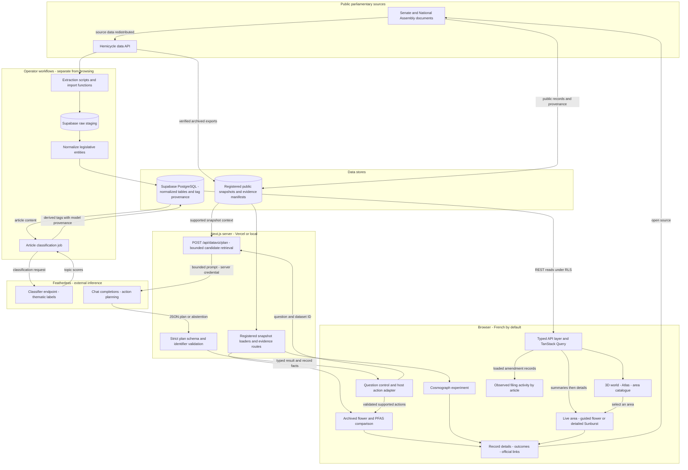

# Dandelion architecture

Documented snapshot: **`cdb9802`**, 14 November 2026. [Back to README](../README.md).

These diagrams describe the implemented architecture. A component appearing in the diagram does not establish that its external service was exercised in the final deployment.

> **Branch scope:** these are reference diagrams for integration `cdb9802`, not a claim that every component is present on `feat/landing-intro`. In particular, the landing checkout does not contain the PFAS assistant route or the archived PFAS pages. See the [documentation index](README.md) for the branch mapping.

## System architecture



Editable sources: [Mermaid](architecture.mmd) · [PlantUML](architecture.puml).

### Boundaries that matter

- **Public snapshots:** the verified PFAS and municipal archives provide reproducible demonstrations without a live Supabase connection. Their metadata and links retain source provenance.
- **Team API:** the browser uses the typed API layer and Supabase reads. Lightweight amendment summaries support the hierarchy; full records are fetched for inspection or comparison. The integration tests used fixtures, and do not establish the state of the live corpus.
- **Ingestion:** extraction, raw staging and normalization are operator workflows. They can write to the database; they are not invoked by a visitor asking a question.
- **Classification:** the separate Featherless batch job reads articles and writes inferred thematic tags with model provenance. Its presence in the code is not evidence of a completed or evaluated tagging run.
- **Assistant:** the server selects bounded candidates from supported snapshots and calls Featherless with a server-side credential. Strict schemas, known identifiers and host capability checks precede action execution.
- **Visualization:** model-assisted control is connected to supported snapshot hosts. The live-area guide is deterministic, and the vehicle in the 3D world is user-controlled.
- **Observed activity:** filing counts and source dates are computed from loaded records. A forecast engine and complete longitudinal article-version tracking are not implemented components in this diagram.

### Additional systems outside the application data flow

Vercel hosts the Next.js application and preview environments. ElevenLabs supplies narration for exported demo videos. Suzan AI supports preparation of a governance, compliance and security review; no runtime audit or certification API is connected. The separate ML feasibility study is a research artifact, not an inference service.

## Assistant request sequence

```mermaid
sequenceDiagram
  autonumber
  actor User
  participant UI as Supported visualization
  participant Route as Next.js plan route
  participant Data as Registered snapshot
  participant Model as Featherless chat API
  participant Validator as Schema and ID validator
  participant Adapter as Host action adapter

  User->>UI: Ask a question in French and request model guidance
  UI->>Route: POST question and datasetId
  Route->>Route: Validate strict input and 600-character limit
  alt No provider key configured
    Route-->>UI: mode = unconfigured
    UI-->>User: Manual and deterministic guidance remain available
  else Provider configured and request valid
    Route->>Data: Load supported snapshot and retrieve candidates
    Data-->>Route: Known IDs and short excerpts
    Route->>Model: Bounded system prompt and user question
    alt Provider timeout or error
      Route-->>UI: Typed provider error
      UI-->>User: Explain failure and retain manual controls
    else Model responds
      Model-->>Route: JSON response
      Route->>Validator: Check size, schema and allowed identifiers
      alt Explicit abstention
        Validator-->>Route: abstain
        Route-->>UI: Typed abstention
        UI-->>User: No supported evidence action for this request
      else Invalid response
        Validator-->>Route: invalid
        Route-->>UI: invalid-response
        Note over UI,Adapter: No model action is executed
      else Valid plan
        Validator-->>Route: Validated actions
        Route->>Data: Resolve facts for selected records
        Data-->>Route: Amendment number, outcome and source URL
        Route-->>UI: Plan and record-derived facts
        UI->>Adapter: Validate complete plan against host capabilities
        alt Host supports the complete plan
          Adapter->>UI: Apply focus, comparison or other supported actions
          UI-->>User: Show selected evidence and official links
        else Unsupported host action
          Adapter-->>UI: Reject plan before execution
        end
      end
    end
  end
  Note over Model,UI: The model plans actions; application records supply facts.
```

Editable sources: [Mermaid](assistant-sequence.mmd) · [PlantUML](assistant-sequence.puml).

### Contract and failure handling

The route receives only a question and a supported dataset identifier. Invalid input is rejected before inference. When configured, the model returns a JSON action plan or explicit abstention. Facts such as amendment outcomes and official links are resolved from application records.

The application validates the entire plan before execution, including the target host’s capabilities. It does not promise automatic rollback if an executing callback fails. A syntactically valid plan can still be irrelevant; semantic accuracy needs a separate evaluation.

Timeouts, invalid output and explicit abstentions remain visible states. They do not become invented factual answers. Manual exploration and deterministic guidance remain available.

## Viewing and editing

- GitHub-compatible Markdown viewers render the Mermaid blocks above. The `.mmd` files are the standalone sources.
- The `.puml` files represent the same two views for PlantUML-compatible editors or a locally installed PlantUML renderer. GitHub does not natively render PlantUML source files.
- With Mermaid CLI already installed, render locally with `mmdc -i docs/architecture.mmd -o docs/architecture.svg`, and repeat for the sequence diagram.
- With PlantUML already installed, render locally with `plantuml -tsvg docs/architecture.puml docs/assistant-sequence.puml`.
- No remote rendering service is required. Renderer commands above are usage instructions; rendering binaries are not bundled.

## Implementation references

- [Application and feature source at the documented commit](https://github.com/baptiste-civiqhub/dandelion-open-data/tree/cdb9802a29b83c97a4a2f1d52c3b3fd45c07e9e9)
- [Team REST API contract](https://github.com/baptiste-civiqhub/dandelion-open-data/blob/cdb9802a29b83c97a4a2f1d52c3b3fd45c07e9e9/docs/dandelion/api.md)
- [Data model and import documentation](https://github.com/baptiste-civiqhub/dandelion-open-data/blob/cdb9802a29b83c97a4a2f1d52c3b3fd45c07e9e9/docs/dandelion/README.md)
- [Featherless integration report](featherless.md)
