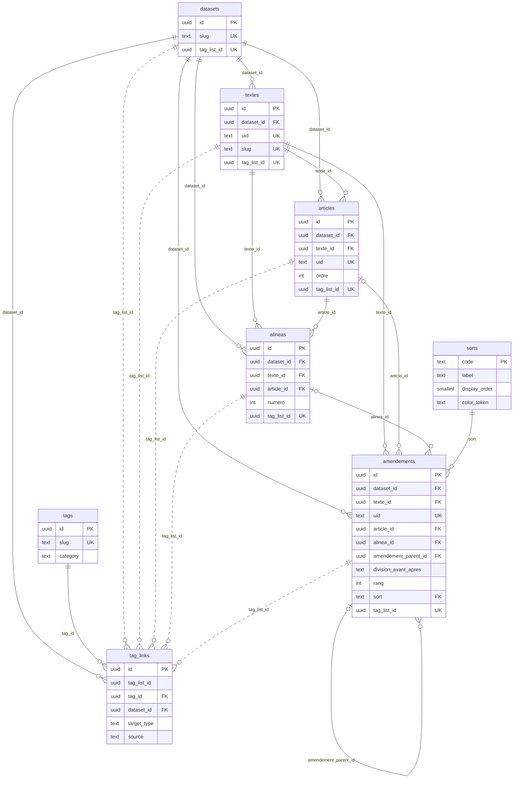

# Schéma DANDELION

Huit tables dans le schéma `public`, aucune vue, aucune fonction. Source : la migration [`20261114132027_dandelion_init.sql`](../../supabase/migrations/20261114132027_dandelion_init.sql), appliquée le 14 novembre 2026.

Chaîne de l'arbre affiché : jeu → texte → article → amendement → sous-amendement. L'alinéa est une précision portée par l'amendement, pas un étage obligatoire.

## Les huit tables

| Table         | Contient                                                                                                                                              | Pointe vers                                                                                                                                                    |
| ------------- | ----------------------------------------------------------------------------------------------------------------------------------------------------- | -------------------------------------------------------------------------------------------------------------------------------------------------------------- |
| `datasets`    | L'objet le plus large : ce qu'on a chargé en une fois, avec sa source, sa licence et son périmètre. Il contient un ou plusieurs textes.               | rien                                                                                                                                                           |
| `textes`      | Un texte de loi à une étape donnée. Racine de l'arbre affiché. Le mot « texte » est celui d'Hémicycle ; il couvre projets et propositions de loi.     | `dataset_id` → `datasets`                                                                                                                                      |
| `articles`    | Un article du texte : l'unité que l'on amende. Colonnes au nom du jeu `articles_textes`.                                                              | `dataset_id` → `datasets`, `texte_id` → `textes`                                                                                                               |
| `alineas`     | Une partie numérotée d'un article. On ne l'amende jamais seul : un amendement vise l'article et précise l'alinéa. Il a sa ligne pour porter des tags. | `dataset_id` → `datasets`, `texte_id` → `textes`, `article_id` → `articles`                                                                                    |
| `amendements` | Même nom que le jeu Hémicycle, mêmes noms de colonnes. Un amendement vise toujours un article, précise parfois un alinéa, et peut avoir un parent.    | `dataset_id` → `datasets`, `texte_id` → `textes`, `article_id` → `articles`, `alinea_id` → `alineas`, `amendement_parent_id` → `amendements`, `sort` → `sorts` |
| `sorts`       | Les huit sorts et leur libellé en langage clair. Livrée remplie par la migration.                                                                     | rien                                                                                                                                                           |
| `tags`        | Le vocabulaire. Créé par la plateforme, jamais par un visiteur.                                                                                       | rien                                                                                                                                                           |
| `tag_links`   | Un tag posé sur un objet. Toutes les lignes d'un même objet partagent son `tag_list_id`.                                                              | `tag_id` → `tags`, `dataset_id` → `datasets`                                                                                                                   |

## Diagramme

Traits pleins : les quatorze clés étrangères. Traits pointillés : le lien par `tag_list_id`, qui n'est pas une clé étrangère.

## Dictionnaire des colonnes

« Peut être vide » = la colonne accepte `null`. Toutes les autres sont `not null`.

### `datasets`

| Colonne        | Type                 | Clés | Rôle ou source                                                   |
| -------------- | -------------------- | ---- | ---------------------------------------------------------------- |
| `id`           | uuid                 | PK   | généré                                                           |
| `slug`         | text                 | UK   | `plf-2027-partie-1`                                              |
| `name`         | text                 |      | libellé affiché                                                  |
| `description`  | text, peut être vide |      |                                                                  |
| `source_label` | text                 |      | mention de source affichée ; valeur par défaut fournie           |
| `license`      | text                 |      | Licence Ouverte ; valeur par défaut fournie                      |
| `perimeter`    | jsonb                |      | filtres de la requête Hémicycle ; `{}` par défaut                |
| `imported_at`  | timestamptz          |      | date de l'import ; `now()` par défaut                            |
| `tag_list_id`  | uuid                 | UK   | identifiant de sa liste de tags, généré ; repris par `tag_links` |

### `textes`

| Colonne         | Type                     | Clés        | Rôle ou source                                                   |
| --------------- | ------------------------ | ----------- | ---------------------------------------------------------------- |
| `id`            | uuid                     | PK          | généré                                                           |
| `dataset_id`    | uuid                     | FK datasets |                                                                  |
| `uid`           | text                     | UK          | `ref_texte_legislatif` (`texte_uid` dans `articles_textes`)      |
| `titre`         | text                     |             | titre du texte                                                   |
| `slug`          | text                     | UK          |                                                                  |
| `legislature`   | smallint, peut être vide |             | `legislature`                                                    |
| `etape_texte`   | text, peut être vide     |             | `etape_texte`                                                    |
| `organe_examen` | text, peut être vide     |             | `organe_examen`                                                  |
| `tag_list_id`   | uuid                     | UK          | identifiant de sa liste de tags, généré ; repris par `tag_links` |

### `articles`

| Colonne       | Type                 | Clés        | Rôle ou source                                                   |
| ------------- | -------------------- | ----------- | ---------------------------------------------------------------- |
| `id`          | uuid                 | PK          | généré                                                           |
| `dataset_id`  | uuid                 | FK datasets | regroupement : tout un jeu en un filtre                          |
| `texte_id`    | uuid                 | FK textes   | depuis `texte_uid`                                               |
| `uid`         | text                 | UK          | identifiant d'article ; à défaut uid du texte + `designation`    |
| `designation` | text                 |             | `designation` : « Article 3 »                                    |
| `titre`       | text, peut être vide |             | `titre`                                                          |
| `dispositif`  | text, peut être vide |             | `dispositif` : le texte de l'article                             |
| `ordre`       | integer              |             | `ordre` : rang dans le texte                                     |
| `tag_list_id` | uuid                 | UK          | identifiant de sa liste de tags, généré ; repris par `tag_links` |

### `alineas`

| Colonne       | Type                 | Clés                 | Rôle ou source                                                   |
| ------------- | -------------------- | -------------------- | ---------------------------------------------------------------- |
| `id`          | uuid                 | PK                   | généré                                                           |
| `dataset_id`  | uuid                 | FK datasets          | regroupement                                                     |
| `texte_id`    | uuid                 | FK textes            | regroupement : tous les alinéas d'un texte en un filtre          |
| `article_id`  | uuid                 | FK articles          |                                                                  |
| `numero`      | integer              | UK avec `article_id` | `alinea_numero`                                                  |
| `designation` | text, peut être vide |                      | `alinea_designation`                                             |
| `dispositif`  | text, peut être vide |                      | texte de l'alinéa, vide s'il n'est pas découpable                |
| `tag_list_id` | uuid                 | UK                   | identifiant de sa liste de tags, généré ; repris par `tag_links` |

### `amendements`

| Colonne                  | Type                        | Clés           | Rôle ou source                                                                                           |
| ------------------------ | --------------------------- | -------------- | -------------------------------------------------------------------------------------------------------- |
| `id`                     | uuid                        | PK             | généré                                                                                                   |
| `dataset_id`             | uuid                        | FK datasets    | regroupement                                                                                             |
| `texte_id`               | uuid                        | FK textes      | depuis `ref_texte_legislatif`                                                                            |
| `uid`                    | text                        | UK             | `uid`                                                                                                    |
| `numero_long`            | text                        |                | `numero_long`                                                                                            |
| `article_id`             | uuid, peut être vide        | FK articles    | article visé, résolu depuis `article_designation_courte`, à défaut `division_titre`. Vide si introuvable |
| `division_titre`         | text, peut être vide        |                | `division_titre`, gardé tel quel                                                                         |
| `division_avant_apres`   | text                        |                | `A`, `AVANT` ou `APRES` : à l'article, avant, après. Normalisé depuis `A`, `Avant`, `Après`              |
| `alinea_id`              | uuid, peut être vide        | FK alineas     | depuis `alinea_numero`. Vide : article entier                                                            |
| `amendement_parent_id`   | uuid, peut être vide        | FK amendements | le parent, s'il est chargé : sous-amendement                                                             |
| `amendement_parent`      | text, peut être vide        |                | `amendement_parent`, gardé tel quel                                                                      |
| `tri_amendement`         | text, peut être vide        |                | `tri_amendement`                                                                                         |
| `rang`                   | integer, peut être vide     |                | rang calculé : par organe d'examen, puis `tri_amendement`                                                |
| `sort`                   | text                        | FK sorts       | code calculé depuis `sort_en_seance`, `etat`, `sous_etat`. `en_attente` par défaut                       |
| `sort_en_seance`         | text, peut être vide        |                | `sort_en_seance`                                                                                         |
| `etat`                   | text, peut être vide        |                | `etat`                                                                                                   |
| `sous_etat`              | text, peut être vide        |                | `sous_etat`                                                                                              |
| `dispositif`             | text, peut être vide        |                | `dispositif`                                                                                             |
| `expose_sommaire`        | text, peut être vide        |                | `expose_sommaire`                                                                                        |
| `signataires_affichable` | text, peut être vide        |                | `signataires_affichable`                                                                                 |
| `acteur_ref`             | text, peut être vide        |                | `acteur_ref`                                                                                             |
| `type_auteur`            | text, peut être vide        |                | `type_auteur`                                                                                            |
| `groupe_politique_ref`   | text, peut être vide        |                | `groupe_politique_ref`                                                                                   |
| `discussion_commune`     | text, peut être vide        |                | `discussion_commune` : regroupe les amendements débattus ensemble                                        |
| `discussion_identique`   | text, peut être vide        |                | `discussion_identique` : regroupe les amendements identiques                                             |
| `date_depot`             | timestamptz, peut être vide |                | `date_depot`                                                                                             |
| `date_sort`              | timestamptz, peut être vide |                | `date_sort`                                                                                              |
| `document_uri`           | text, peut être vide        |                | `document_uri`                                                                                           |
| `tag_list_id`            | uuid                        | UK             | identifiant de sa liste de tags, généré ; repris par `tag_links`                                         |

Contrainte `amendements_pas_son_propre_parent` : un amendement ne peut pas être son propre parent.

### `sorts`

| Colonne         | Type     | Clés | Rôle ou source                 |
| --------------- | -------- | ---- | ------------------------------ |
| `code`          | text     | PK   | l'un des huit codes ci-dessous |
| `label`         | text     |      | libellé en langage clair       |
| `display_order` | smallint |      | ordre de la légende            |
| `color_token`   | text     |      | nom de variable CSS            |

Contenu livré par la migration :

| `code`        | `label`                                                  | `display_order` | `color_token`        |
| ------------- | -------------------------------------------------------- | --------------- | -------------------- |
| `adopte`      | Voté : le texte est modifié                              | 1               | `--sort-adopte`      |
| `rejete`      | Repoussé par un vote : le texte ne change pas            | 2               | `--sort-rejete`      |
| `tombe`       | Devenu sans objet après l'adoption d'un autre amendement | 3               | `--sort-non-vote`    |
| `retire`      | Son auteur y a renoncé                                   | 4               | `--sort-non-vote`    |
| `non_soutenu` | Personne ne l'a défendu en séance                        | 5               | `--sort-non-vote`    |
| `irrecevable` | Écarté avant le débat, car contraire aux règles de dépôt | 6               | `--sort-irrecevable` |
| `en_attente`  | Pas encore examiné                                       | 7               | `--sort-en-attente`  |
| `autre`       | Sort non reconnu : à vérifier                            | 8               | `--sort-en-attente`  |

### `tags`

| Colonne       | Type                 | Clés | Rôle ou source                                     |
| ------------- | -------------------- | ---- | -------------------------------------------------- |
| `id`          | uuid                 | PK   | généré                                             |
| `slug`        | text                 | UK   | `fiscalite`                                        |
| `label`       | text                 |      | Fiscalité                                          |
| `category`    | text                 |      | regroupe les tags par famille ; `theme` par défaut |
| `description` | text, peut être vide |      |                                                    |

### `tag_links`

| Colonne       | Type                 | Clés             | Rôle ou source                                          |
| ------------- | -------------------- | ---------------- | ------------------------------------------------------- |
| `id`          | uuid                 | PK               | généré                                                  |
| `tag_list_id` | uuid                 | UK avec `tag_id` | celui de l'objet étiqueté : regroupe ses tags           |
| `tag_id`      | uuid                 | FK tags          |                                                         |
| `dataset_id`  | uuid                 | FK datasets      | regroupement : tous les liens d'un jeu en un filtre     |
| `target_type` | text                 |                  | `dataset`, `texte`, `article`, `alinea` ou `amendement` |
| `source`      | text                 |                  | `manual`, `script` ou `inference` ; `manual` par défaut |
| `confidence`  | real, peut être vide |                  | entre 0 et 1, pour une inférence                        |
| `model`       | text, peut être vide |                  | nom du script ou du modèle                              |
| `created_at`  | timestamptz          |                  | `now()` par défaut                                      |

## Les règles à connaître

- **Vocabulaire.** Une table ou une colonne copiée d'Hémicycle garde le nom d'Hémicycle (`numero_long`, `dispositif`, `division_avant_apres`). Une colonne calculée ou technique a un nom à nous (`rang`, `sort`, `tag_list_id`). `datasets`, `tags`, `tag_links` et leurs colonnes restent en anglais.
- **`tag_list_id`.** Chaque objet étiquetable (`datasets`, `textes`, `articles`, `alineas`, `amendements`) porte un `tag_list_id` unique, généré par la base. `tag_links.tag_list_id` reprend cette valeur. Ce n'est ni une clé primaire ni une clé étrangère : c'est la colonne de regroupement qui rend tous les tags d'un objet d'un seul filtre, quel que soit le type d'objet. Un script ne l'envoie jamais : il le lit sur l'objet.
- **Colonnes de regroupement.** `dataset_id` est présent sur toutes les tables d'objets et sur `tag_links`, pour charger ou supprimer un jeu d'un seul filtre. `texte_id` est présent sur `articles`, `alineas` et `amendements`. `target_type` sur `tag_links` permet de lire en une requête tous les liens d'un type d'objet. `discussion_commune` et `discussion_identique` regroupent les amendements débattus ensemble.
- **Article, alinéa, amendement.** L'article est l'unité que l'on amende. Un alinéa est une partie numérotée d'un article ; on ne l'amende jamais seul : l'amendement vise l'article (`article_id`) et précise l'alinéa (`alinea_id`) ou non. Un sous-amendement est un amendement qui a un parent (`amendement_parent_id`). Un article additionnel reste un amendement : `division_avant_apres` vaut `AVANT` ou `APRES`, et aucune ligne `articles` n'est créée. Une suppression se lit dans le `dispositif`.
- **Sort.** `amendements.sort` est un code parmi huit, calculé à l'import depuis les libellés bruts `sort_en_seance`, `etat`, `sous_etat`, gardés à côté. La table `sorts` porte le libellé, l'ordre et la couleur de la légende.
- **Tags.** Le vocabulaire de tags est posé par la plateforme. Les liens sont écrits par des scripts ou par inférence, avec `source`, `confidence` et `model` pour savoir d'où vient chaque lien.
- **Sécurité.** RLS est activée sur les huit tables, avec une seule politique, « lecture publique ». Les rôles `anon` et `authenticated` lisent ; seule la clé secrète écrit. Supprimer un jeu supprime en cascade ses textes, articles, alinéas, amendements et liens de tags ; le vocabulaire `tags` reste.

## Pourquoi ce modèle

1. **Un backend d'un après-midi.** Huit tables, zéro vue, zéro fonction, zéro historique de versions. Tout ce qui peut se calculer dans le navigateur (arbre, liens entre amendements discutés ensemble, regroupement des tags) s'y calcule. Chaque table en plus serait du temps pris sur la visualisation.
2. **Le vocabulaire d'Hémicycle, sans traduction.** Les tables s'appellent `textes`, `articles`, `alineas`, `amendements`, et les colonnes copiées gardent leur nom d'origine. Le script d'import recopie au lieu de renommer, et quiconque connaît le jeu Hémicycle lit la base sans lexique. « Texte » couvre les projets de loi et les propositions de loi, ce qui évite le mot « proposition », ambigu.
3. **Un jeu de données comme conteneur.** `datasets` est l'objet le plus large : ce qu'on a chargé en une fois, avec sa source, sa licence et son périmètre. On peut afficher la provenance, recharger un jeu ou le supprimer d'un seul geste.
4. **L'arbre vient des données, pas d'un type d'amendement.** Il n'y a aucune colonne « type » (création, modification, suppression). La position d'un amendement se lit dans trois colonnes : l'article visé, l'alinéa précisé, l'amendement parent. `division_avant_apres` suffit à distinguer un article additionnel.
5. **L'alinéa a sa table.** Les amendements citent des alinéas, et l'on veut pouvoir étiqueter un alinéa et compter les amendements qui le précisent. Une table dédiée, remplie d'abord par les alinéas que les amendements citent, coûte peu et rend l'alinéa adressable.
6. **Les tags par `tag_list_id`.** Cinq types d'objets portent des tags. Plutôt que cinq tables de liens ou cinq colonnes de cible, chaque objet porte un identifiant de liste, et `tag_links` le reprend. Une seule forme de requête et une seule forme d'écriture servent tous les types. Le prix : ce lien n'a pas de clé étrangère ; un contrôle SQL repère les liens orphelins (contrôle 06 de [`essai-a-blanc.sql`](essai-a-blanc.sql)), et la suppression d'un jeu emporte ses liens grâce à `dataset_id`.
7. **Des colonnes de regroupement recopiées.** `dataset_id` et `texte_id` sont répétés sur les tables filles pour que le front-end charge tout un texte d'un seul filtre, sans jointure. Le script d'import les recopie ; des contrôles vérifient leur cohérence (contrôle 07 de l'essai à blanc).
8. **Le sort normalisé, le brut gardé.** Les libellés d'Hémicycle sont nombreux. Un code parmi huit sert la légende et les filtres ; les libellés bruts restent à côté pour vérifier la normalisation.
9. **Lecture publique, écriture par script.** Les données sont publiques et l'application n'a pas de comptes. Le front-end lit avec la clé publiable ; RLS interdit toute écriture hors de la clé secrète.
10. **Auteurs en colonnes.** Auteur, groupe politique et signataires restent des colonnes de texte sur l'amendement. Une table d'acteurs n'apporterait rien à l'arbre aujourd'hui.

## Provenance des noms de colonnes

Les noms repris d'Hémicycle ont été vérifiés sur les réponses réelles stockées dans le schéma `raw` : toutes les colonnes copiées existent dans les jeux `amendements` et `articles_textes`. Deux règles du dictionnaire ont été ajustées d'après ces données, la résolution de l'article visé et la normalisation de `division_avant_apres` ; le détail est dans [`import.md`](import.md).
