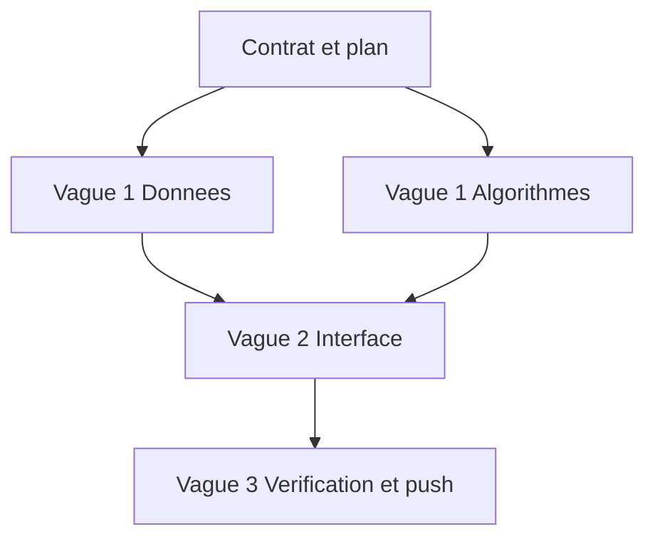

# Pissenlit — premier jet (14 novembre 2026)

Plan d’exécution. Les décisions du brief sont reprises ici et précisées. Les sous-agents n’en changent pas le sens. Aucun appel Hémicycle pendant l’écriture de ce plan.

## Décisions figées

- Snapshot Hémicycle enregistré dans le repo. La page et les tests tournent sans réseau.
- Un texte réel d’environ 150 à 400 amendements. Au-delà de 400, en prendre un autre. Un PLF dépasse le plafond de crédits : ne pas le choisir.
- Fleur au repos, fisheye qui ouvre un pétale, graine `reste`, fiche d’un amendement, tests de la coupe, vérification dans le navigateur. Pas de curseur de dates.
- Branche `feat/pissenlit-texte` depuis `main` à jour. Commit unique par l’orchestrateur, puis `git push -u origin HEAD`. Pas de PR, pas de force-push, pas de push de `main`. Remote : `https://github.com/baptiste-civiqhub/dandelion-open-data`.
- Aucune dépendance nouvelle. Courbes SVG en TypeScript. `d3-hierarchy` n’est pas ajouté : la géométrie ci-dessous suffit.
- État git actuel : `main` suit `origin/main`. `feat/pissenlit-texte` est absente. `docs/pissenlit-agents.md` est non suivi et reste hors du commit.

## 1. Fichiers et propriétaire

Un fichier, un propriétaire. Seul l’orchestrateur commit. Les sous-agents ne poussent pas, n’appellent pas Hémicycle hors de l’agent données, et ne sortent pas de leur liste. S’ils doivent changer [apis/texte/types.ts](apis/texte/types.ts), ils s’arrêtent.

**Planificateur** (avant toute délégation)

- [docs/pissenlit-plan.md](docs/pissenlit-plan.md) — copie datée de ce plan, section « Texte choisi » vide.
- [apis/texte/types.ts](apis/texte/types.ts) — contrat copié tel quel, sans logique.

**Données** — vague 1, en parallèle des algorithmes

- [features/texte/fixtures/texte-amendements.json](features/texte/fixtures/texte-amendements.json)
- [apis/texte/request.ts](apis/texte/request.ts), [apis/texte/queries.ts](apis/texte/queries.ts), [apis/texte/index.ts](apis/texte/index.ts)
- une clé dans [types/queryKeyEnum.ts](types/queryKeyEnum.ts)
- le paragraphe « Texte choisi » de [docs/pissenlit-plan.md](docs/pissenlit-plan.md), et rien d’autre dans ce fichier

**Algorithmes** — vague 1

- [features/texte/lib/](features/texte/lib/) uniquement

**Interface** — vague 2, après la vague 1

- [features/texte/components/](features/texte/components/)
- [app/[locale]/texte/page.tsx](app/[locale]/texte/page.tsx)
- [constant/path.ts](constant/path.ts) : `PUBLIC_PATHS.TEXTE = '/texte'`
- [i18n/messages/fr.json](i18n/messages/fr.json) et [i18n/messages/en.json](i18n/messages/en.json), namespace `texte`, plus la clé du lien d’accueil
- le lien dans [features/home/components/home-screen.tsx](features/home/components/home-screen.tsx), via `Link` de `@/i18n/navigation`

`request.ts` importe la fixture et renvoie un `TexteSnapshot`. Pas de Supabase, pas de `fetch`. `useGetTexteAmendements` suit le modèle de [apis/health/queries.ts](apis/health/queries.ts) : `queryKey: [QueryKeysEnum.GET_TEXTE_AMENDEMENTS]`, `staleTime: Infinity`. La page reste fine (metadata + `setRequestLocale`), comme le skill `ajouter-une-page`. L’écran est client.

## 2. Contrat de données

Copier ce bloc dans `apis/texte/types.ts`, sans rien ajouter.

```ts
export type Intention = 'supprimer' | 'reecrire' | 'ajouter' | 'modifier' | 'autre'

export type Amendment = {
  id: string
  numero: string
  article: string
  dispositif: string
  expose: string | null
  parentId: string | null
  discussionCommune: string | null
  discussionIdentique: string | null
  authorLabel: string | null
  groupLabel: string | null
  sort: string | null
}

export type TexteSnapshot = {
  id: string
  titre: string
  sourceNom: string
  sourceUrl: string
  licence: string
  amendments: Amendment[]
}

export type NodeKind = 'texte' | 'article' | 'intention' | 'discussion' | 'doublon' | 'amendement' | 'reste'

export type DandelionNode = {
  id: string
  kind: NodeKind
  label: string
  weight: number
  children: DandelionNode[]
  amendmentId?: string
}

export type LayoutNode = {
  id: string
  kind: NodeKind
  label: string
  weight: number
  depth: number
  angle0: number
  angle1: number
  radius: number
  x: number
  y: number
  parentId: string | null
  amendmentId?: string
}
```

La fixture JSON a déjà cette forme. `resolveJsonModule` est activé. Pas de fonction de mapping séparée, donc pas de test réseau.

Champs, après lecture de `lister_jeux` (les noms de colonnes réels priment s’ils diffèrent, et le mapping est noté dans « Texte choisi ») :

- `article` : `article_designation_courte`, sinon `division_titre`, sinon `"texte entier"`.
- `authorLabel` : `signataires_affichable`. Pas d’appel à une fiche acteur.
- `groupLabel` et `sort` : colonnes d’affichage indiquées par `lister_jeux`, sinon `null`.
- `parentId`, `discussionCommune`, `discussionIdentique`, `dispositif`, `expose`, `numero`, `id` : colonnes du jeu `amendements`.

Niveaux, du centre vers l’extérieur. Un niveau est sauté pour un parent lorsque le champ est vide chez tous ses enfants :

1. `texte`
2. `article`
3. `intention`
4. `discussion` (`discussionCommune`)
5. `doublon` (`discussionIdentique`)
6. `amendement`
7. un sous-amendement (`parentId` résolu dans le snapshot) est enfant de son amendement, pas de l’article. Un parent absent, ou un cycle, se rattache à son article.

## 3. Contrat des fonctions pures

Constantes dans [features/texte/lib/constants.ts](features/texte/lib/constants.ts) :

- `MAX_VISIBLE = 150`
- `FOCUS_SHARE = 0.4`
- `EXPAND_ARC_PX = 36`
- `LABEL_ARC_PX = 48`
- `OUTER_RADIUS_PX = 320` pour les tests. L’écran passe le rayon réel.
- `ANGLE_ORIGIN = -Math.PI / 2`
- `INTENTION_HEAD = 400`

Aucun import de React, Next, next-intl, Supabase ni `services/`. `import type` depuis `@/apis/texte/types` seulement. Pas de `Date.now()` ni d’aléatoire.

Signatures :

- `classifyIntention(dispositif: string): Intention`
- `buildTree(snapshot: TexteSnapshot): DandelionNode`
- `cutTree(tree: DandelionNode, args: { focusId: string | null; budget: number; outerRadiusPx: number }): DandelionNode`
- `layoutRadial(visible: DandelionNode, args: { focusId: string | null; focusShare: number; outerRadiusPx: number }): LayoutNode[]`

Un helper interne `assignAngles` dans `features/texte/lib/angles.ts` est permis. Il ne fait pas partie du contrat public : `cutTree` et `layoutRadial` s’en servent.

### classifyIntention

Sur les 400 premiers caractères, apostrophes unifiées, casse ignorée, accents retirés. Premier motif qui gagne :

1. `supprimer` → `supprimer`
2. `rediger ainsi` → `reecrire`
3. `completer`, `inserer`, ou `apres l'alinea` → `ajouter`
4. `substituer` ou `remplacer` → `modifier`
5. sinon, y compris chaîne vide → `autre`

### buildTree

- Poids d’une feuille amendement : `1`. Poids d’un parent : somme des enfants. Snapshot vide : un nœud `texte`, poids `0`, `label = titre`.
- Ordre des articles, intentions, discussions et doublons : première apparition dans `amendments`. Les articles ne sont pas triés alphabétiquement.
- Identifiants stables : `texte:${snapshot.id}`, `article:${article}`, `${parentId}/intention:${intention}`, `${parentId}/discussion:${valeur}`, `${parentId}/doublon:${valeur}`, `amendement:${amendment.id}`. Valeur vide autorisée dans l’id.
- `label` : titre, désignation d’article, valeur d’`Intention`, libellé de discussion, numéro. Groupe vide : `label` `''`.
- `amendmentId` présent sur les nœuds `amendement` seulement.
- Le poids d’un article inclut ses sous-amendements. Un sous-amendement n’est pas aussi rangé sous son propre article.

### Angles

- Radians. Le cercle complet vaut `2π`. Origine `ANGLE_ORIGIN` (haut). L’angle croît dans le sens trigonométrique. `x = r cos(mid)`, `y = r sin(mid)`, `mid = (angle0 + angle1) / 2`.
- L’article focal, s’il y en a d’autres, occupe exactement `focusShare * 2π`. Les autres se partagent le reste, dans l’ordre d’origine. S’il est seul, il occupe `2π`.
- Plancher d’article : `LABEL_ARC_PX / outerRadiusPx`, abaissé pour que la somme des planchers tienne dans l’arc disponible. Le reliquat est proportionnel au poids. Poids total nul : parts égales.
- Les enfants d’un nœud non-article se partagent l’arc du parent au prorata du poids, sans plancher, dans l’ordre de `children`.
- `focusId` sur une intention ou un amendement : l’article qui le contient reçoit `focusShare`.

### cutTree

L’arc en pixels vaut `(angle1 - angle0) * outerRadiusPx`, calculé sur l’arbre complet avant la coupe.

Un nœud s’ouvre si :

- sans focus : le `texte` s’ouvre toujours ; un `article` s’ouvre si son arc vaut au moins `EXPAND_ARC_PX` ; rien d’autre ne s’ouvre. La coupe s’arrête donc à `intention` ;
- avec focus : le focus et ses ancêtres s’ouvrent même sous le seuil ; les autres articles suivent la règle du repos. Les descendants du focus ne s’ouvrent pas tant qu’ils ne sont pas eux-mêmes le focus. Survoler une intention montre ses enfants directs (souvent les amendements) et laisse les intentions sœurs fermées.

Ensuite le budget, à chaque nœud ouvert :

- une feuille ne reçoit pas d’enfants ;
- les enfants candidats restent dans l’ordre d’origine pour l’angle ; la priorité de prélèvement est : l’enfant qui contient le focus, puis le poids décroissant, puis l’index d’origine ;
- le nœud compte pour 1. S’il reste des exclus, un slot est réservé à une seule graine `reste` (`id` `${parent.id}/reste`, `kind` `reste`, `label` `'reste'`, poids = somme des exclus, sans enfants) ;
- les slots restants vont aux enfants prioritaires. Le reliquat de budget après un slot par enfant retenu va d’abord à l’enfant prioritaire, pour sa propre coupe ;
- le nombre de nœuds du résultat ne dépasse jamais `budget`. Le poids du parent est inchangé.

### layoutRadial

- Entrée : l’arbre déjà coupé. Angles recalculés sur ses poids.
- `depth` 0 à la racine, rayon `0`. Le pas vaut `outerRadiusPx / maxDepth`. Le dernier anneau est sur `outerRadiusPx`.
- Liste en préordre. `parentId` null à la racine.
- Les enfants restent à l’intérieur de `[angle0, angle1]` du parent.

### Tige et pétale

Dans le composant, sans librairie. Secteur annulaire entre le rayon du parent et le rayon du nœud, de `angle0` à `angle1`. Tige quadratique du point parent au point enfant, point de contrôle à mi-rayon sur l’angle milieu de l’enfant. Un nœud dont l’arc est sous `LABEL_ARC_PX` n’a pas de libellé SVG.

## 4. Cas de test

`describe` / `it` / `expect` depuis `vitest`. Builders de cinq à vingt amendements. Aucun import de la fixture. Un `it` par cas, descriptions en anglais. `pnpm test features/texte` vert avant de rendre la main.

`classifyIntention`

- returns autre for an empty string
- returns autre for an unknown formula
- returns supprimer for « Supprimer cet article »
- returns reecrire for « Rédiger ainsi »
- returns ajouter for « Compléter »
- returns ajouter for « Après l'alinéa »
- returns ajouter for « Insérer »
- returns modifier for « Substituer »
- returns modifier for « Remplacer »

`buildTree`

- returns a texte node of weight 0 when there are no amendments
- omits discussion and doublon levels when both fields are null
- attaches an amendment to its article when the parent is unknown
- nests a sub-amendment under its parent amendment

`cutTree`

- hides amendment leaves and stays within MAX_VISIBLE without focus — arbre issu de `buildTree`
- emits one reste seed and respects the budget when an article has more than MAX_VISIBLE children — arbre synthétique, focus sur cet article, `budget = MAX_VISIBLE`
- does not add children to a leaf

`layoutRadial`

- keeps the same circular article order with and without focus — quatre articles de poids égal
- gives the focused article a larger angle — ce focus occupe `FOCUS_SHARE` du cercle, donc plus que son quart
- keeps children inside the parent angle

## 5. Écran

- Rayon extérieur = 40 % du plus petit côté du cadre (`ResizeObserver`), passé à `cutTree` et `layoutRadial`. Budget = `MAX_VISIBLE`.
- Repos : `focusId` null. Anneaux article et intention seulement.
- `focusId = pinnedId ?? hoveredId`. Survol d’un pétale : son id. Clic : épingle. Clic sur une feuille : épingle et ouvre la fiche. Clic sur le fond : ferme la fiche s’il y en a une, sinon délaisse l’épingle.
- La lignée jusqu’au centre reste opaque ; le reste passe à `opacity-30`. L’ouverture s’anime avec `motion` (`motion/react`, déjà en 12.7.4).
- Couleurs : `var(--chart-1)` … `var(--chart-5)` pour `supprimer`, `reecrire`, `ajouter`, `modifier`, `autre`. Le reste des nœuds utilise `fill-muted` / `currentColor`. Aucun hex ni `oklch` dans le JSX.
- Fiche : numéro, auteur, groupe, intention traduite, extrait du dispositif (280 caractères), sort. Libellés de chrome via `useTranslations('texte')`. Valeur absente : clé `unknown`.
- Quatre états : `Skeleton`, erreur, vide, fleur. SVG `role="img"` et `aria-label`.
- Lien d’accueil à côté du lien de santé existant, libellé `home.texteLink`.

Clés `texte` dans les deux catalogues : `metaTitle`, `title`, `loading`, `error`, `empty`, `flowerLabel`, `reste`, `unknown`, `intentions.supprimer|reecrire|ajouter|modifier|autre`, `sheet.numero|author|group|intention|dispositif|sort|close`, `sansDiscussion`, `sansDoublon`.

## 6. Définition de fini

Cochée par l’orchestrateur, seul, après la vague 2.

- `pnpm check` était vert avant la première modification. S’il est rouge, on s’arrête.
- `pnpm check` est vert à la fin. Aucun test supprimé, `skip`, ni vidé.
- `pnpm dev` hors bac à sable si aucun serveur ne tourne, sans afficher l’environnement. Page `http://localhost:3000/texte`.
- La fleur montre des pétales. Survoler un pétale l’ouvre. Cliquer une feuille affiche le numéro et l’extrait. La console n’a pas d’erreur de rendu.
- `pnpm format` sur les fichiers touchés si le style s’écarte.
- Branche absente du remote, commit unique :

```
feat(texte): afficher un texte et ses amendements en fleur radiale
```

- `git push -u origin HEAD`. URL de la branche rendue. Pas de pull request.

## 7. Texte choisi

- Identifiant : `PRJLANR5L17B2464`
- Titre : projet de loi relatif à l’extension des prérogatives, des moyens, de l’organisation et du contrôle des polices municipales et des gardes champêtres
- Nombre d’amendements : 392
- Source : Assemblée nationale
- Licence : Licence Ouverte (Etalab)
- URL source : https://data.assemblee-nationale.fr
- Crédits dépensés : 25 (15 déjà dépensés, 10 pour ce choix)
- Mapping : `id` = `uid` ; `numero` = `numero_long` sinon `numero` ; `article` = `article_designation_courte`, sinon `division_titre`, sinon « texte entier » ; `dispositif` = `dispositif` ou chaîne vide ; `expose` = `expose_sommaire` ou null ; `parentId` = `amendement_parent` ou null ; `discussionCommune` = `discussion_commune` ou null ; `discussionIdentique` = `discussion_identique` ou null ; `authorLabel` = `signataires_affichable` ou null ; `groupLabel` = null (`groupe_politique_ref` est un identifiant, pas un libellé) ; `sort` = `sort_en_seance` ou null. Les chaînes vides de l’API deviennent null pour les champs nullables.

## Orchestration



Avant d’écrire : `pnpm check`. S’il est rouge, arrêt.

Vague 1, données, plafond 15 crédits, outils `lister_jeux` (une fois, gratuit), `rechercher`, `interroger` :

- colonnes et filtres de `amendements` d’abord ;
- compter un seul texte, 200 lignes par page ; si la troisième page est pleine, ou si le total dépasse 400, abandonner sans stocker ;
- tenir le compte affiché par les réponses ; s’arrêter à 15 ;
- si aucun texte admissible n’est trouvable dans le plafond, arrêt sans contourner.

Vague 3 : si le parcours navigateur échoue, corriger et le refaire. L’orchestrateur ne réécrit le code des sous-agents que pour raccorder un import cassé.
